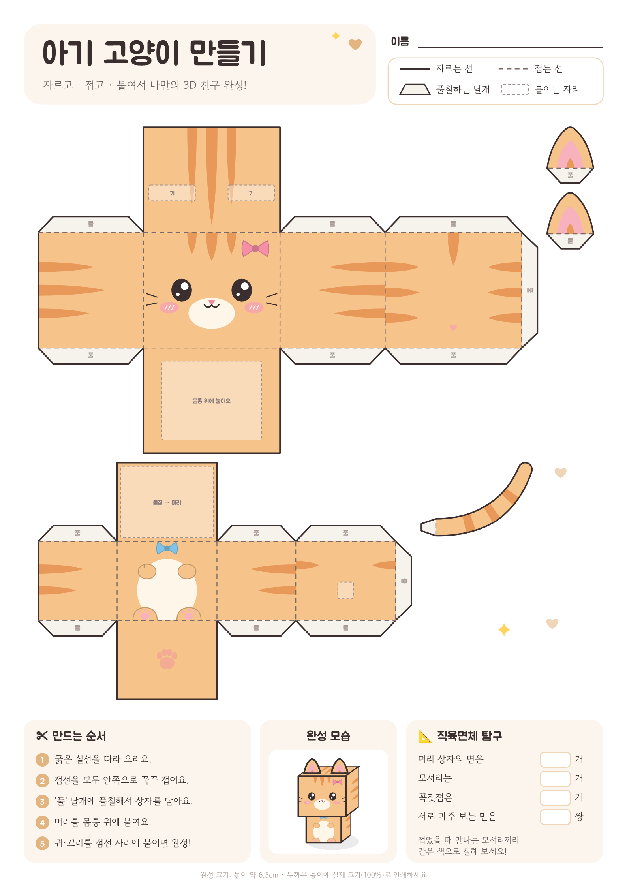
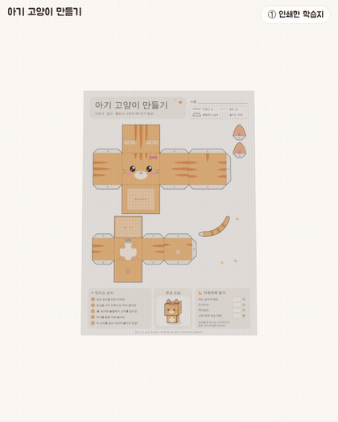

# papercraft · 페이퍼크래프트 학습지 MCP

"고양이 페이퍼크래프트 만들어 줘" 한마디로 **바로 인쇄할 수 있는 A4 학습지**가 나오고, **3D 로 가상 접기**까지 보여 주는 스킬 + MCP 서버.




- 큰 머리 + 작은 몸통 직육면체 두 개, 귀·꼬리는 날개를 접어 붙이는 귀염 스타일(레퍼런스에서 뽑은 규칙: `skills/papercraft/references/style-guide.md`)
- 학습지 한 장: 제목·이름 칸·범례 / 전개도 / 만드는 순서·완성 모습·탐구 활동(직육면체의 면·모서리·꼭짓점, 초5 수학)
- 프리셋 12종: cat, graycat, bunny, bear, panda, penguin, fox, raccoon, koala, hamster, chick, frog — 색·귀·얼굴 무늬·꼬리·장식을 바꿔 새 동물도 만든다
- 나오는 것: 인쇄용 HTML·SVG·PDF·PNG, 3D 접기 HTML, 접기 장면표·MP4·GIF
- 의존성 없음(Node 18+). PDF·PNG·영상은 Playwright(+ffmpeg) 가 있으면 자동으로 만든다

## 붙이기

**Claude Code 플러그인**

```text
/plugin marketplace add nalssam/eduAI
/plugin install papercraft@nalssam
```

**다른 MCP 클라이언트(Claude Desktop, Codex, Cursor …)** — 저장소를 받은 뒤 설정에 넣는다.

```json
{ "mcpServers": { "papercraft": { "command": "node", "args": ["/경로/eduAI/plugins/papercraft/server/mcp.js"] } } }
```

PDF·PNG·접기 영상까지 원하면 `npm i -g playwright && npx playwright install chromium` (영상은 ffmpeg 도).

## 도구

| 도구 | 하는 일 |
|---|---|
| `papercraft_style_guide` | 스타일 규칙·명세 항목·프리셋 목록 |
| `create_papercraft_worksheet` | 명세(프리셋 + 바꿀 값) → A4 학습지 파일들 + 미리보기 이미지 |
| `render_fold_preview` | 3D 접기 HTML → 장면 사진·장면표·MP4·GIF |

## 명령줄

```bash
node cli.js --preset fox --activity story --out ./out
node test/smoke.js ./out cat     # MCP 로 만들고 접어 보는 시험
```

## 짜임

| 파일 | 하는 일 |
|---|---|
| `lib/spec.js` | 프리셋과 명세 정리 |
| `lib/art.js` | 얼굴·무늬·귀·꼬리 그림(SVG) |
| `lib/parts.js` | 상자 전개도·풀칠 날개·경첩, 조립 위치 |
| `lib/sheet.js` | A4 배치(MaxRects, 자동 축소)·머리띠·아래 칸·완성 투상도 |
| `lib/fold.js` | 같은 경첩 데이터로 접는 three.js 미리보기 |
| `lib/foldrender.js` · `lib/output.js` | PNG·PDF·영상 내보내기 |
| `server/mcp.js` | stdio MCP 서버 |
